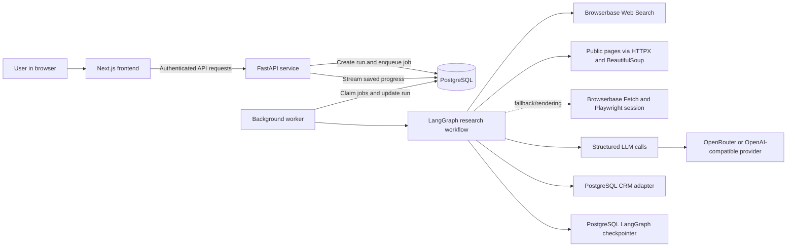

# Lead Research & CRM Loader — Project Brief for Presentation

## Purpose of this brief

This document describes the repository as it is currently implemented and gives a presenter enough context to prepare a detailed project deck. Treat suggested roadmap items as future work, not as shipped features. Avoid inventing performance, accuracy, or customer metrics; none are established in this repository.

## 1. Executive summary

**Lead Research & CRM Loader** is a web application and AI-assisted research workflow for building evidence-backed lists of companies. A user describes a target market using an industry, region, optional employee-count range, and qualification criteria. The system discovers candidate companies, researches public pages, records evidence, assesses qualification, and presents a reviewable proposal. The user must approve selected companies before they are written to the application's PostgreSQL-backed CRM store.

The core product idea is **research with provenance and human control**: the agent can gather and assess evidence, but it does not silently import its proposed companies. It keeps uncertain results visible, records the reasoning and source trail, and independently reads imported records back for verification.

The current project includes account sign-in, private run history, live progress events, a lead-review dashboard, approval, CRM persistence, synthetic mock mode, and an optional strict employee-count check. The project currently implements its own PostgreSQL CRM table behind an adapter; the code does not show a production integration with Salesforce, HubSpot, or another external CRM.

## 2. Problem and value proposition

Sales and go-to-market teams often need to assemble company prospect lists from scattered public information. Manual research is repetitive, source details are easy to lose, and weak matches can enter a CRM without clear justification.

This application aims to:

- Automate candidate discovery and first-pass company research.
- Preserve source URLs, excerpts, timestamps, and evidence identifiers for review.
- Separate qualification decisions from deterministic checks such as numeric employee limits and citation validity.
- Keep uncertain or unsupported candidates out of the import proposal.
- Require an explicit user decision before CRM writes.
- Show progress, decisions, call usage, and a final report for each run.

The expected audience is sales development, lead-research, and sales-operations teams that need structured company research and a controlled handoff into a CRM. This audience is inferred from the application's scope and terminology.

## 3. Main user journey

1. The user registers or signs in.
2. The user creates a research request by entering an industry/category, city or region, optional employee minimum/maximum, and qualification criteria.
3. The user may enable **Strict search** to verify employee-size bounds against an independent public source before proposal preparation.
4. The frontend submits a request to the FastAPI service. The target count displayed by the UI is controlled by server configuration.
5. The API creates an owned run record and queues work. In Compose deployments, a separate worker claims and executes the job.
6. The research graph searches, filters, researches, qualifies, deduplicates, and verifies candidates while writing progress events and candidate updates.
7. The dashboard displays live stages and activity, a **Qualified leads** section, and the broader company-evidence view with decision/status filters and CSV export.
8. The workflow prepares a versioned, hashed proposal containing eligible qualified companies.
9. The user reviews the proposal and selects records to approve, or rejects it.
10. Only approved candidate IDs are upserted to the PostgreSQL CRM table. The workflow reads records back and verifies the intended company name and domain.
11. The run report summarizes decisions, shortfall, import outcomes, failures, and provider usage.

## 4. Technology stack

| Layer | Technology | Role in the project |
|---|---|---|
| Web UI | Next.js 15, React 19, TypeScript | Dashboard, account screens, research request form, live run details, proposal approval, and history |
| UI styling and interaction | CSS; Motion; Lucide React | Existing visual theme, transitions, and interface icons |
| API | Python 3.11+, FastAPI, Uvicorn | Authenticated HTTP API, run creation, event streaming, approvals, reports, and CRM reads |
| Input/output models | Pydantic 2 | Request validation, candidate/evidence contracts, approval validation, and structured model outputs |
| Agent workflow | LangGraph 1.x | Stateful graph for discovery through approval, import, and reporting |
| Model integration | LangChain OpenAI integration (`langchain-openai`) | Structured-output classification and employee-count assessments through an OpenAI-compatible provider |
| Supported model providers | OpenRouter, OpenAI-compatible API, or configured provider/base URL | Company qualification and strict employee-count interpretation; model and endpoint are configurable |
| Web search | Browserbase Web Search API | Live public-web search for discovery and optional strict employee-count research |
| Page research | HTTPX, BeautifulSoup 4, Playwright, Browserbase Fetch | Direct public-page retrieval and parsing, with Browserbase fallback and short-lived browser rendering for certain JavaScript pages |
| Persistence | PostgreSQL 16; psycopg 3 connection pools | Durable run state, events, job queue, account/session records, checkpointing, and CRM company records |
| Workflow checkpointing | `langgraph-checkpoint-postgres` | Persisted LangGraph state across worker execution and approval interruption/resume |
| Tracing | LangSmith (optional) | Optional graph/model tracing when enabled and configured |
| Authentication | Argon2 password hashing; signed/hashed opaque tokens; cookie sessions; CSRF token header | Account login, sessions, email verification/reset tokens, and protection for state-changing requests |
| Local deployment | Docker Compose | Runs the database, API, background worker, and frontend as separate services |
| Developer validation | pytest, pytest-asyncio, Ruff (optional development dependencies) | Scenario tests and Python linting are available in the backend development extras |

Dependency ranges live in `frontend/package.json` and `lead-research-crm-loader/pyproject.toml`. The code uses a provider abstraction for web search, page reading, qualification, CRM persistence, and run storage so those adapters can be replaced without redesigning graph control flow.

## 5. System architecture



### Runtime components

- **Frontend service:** Next.js app served on port 3000. It calls the API with browser credentials and reads run events through a server-sent event stream.
- **Backend API service:** FastAPI app on port 8000. It authenticates users, creates runs, exposes event/report endpoints, validates approvals, and serves CRM reads.
- **Worker service:** A long-running process that claims durable jobs, executes the LangGraph workflow, checkpoints progress, and resumes the graph after approval.
- **PostgreSQL service:** Stores user accounts/sessions/auth tokens, runs, events, queued jobs, graph checkpoints, and CRM company records. Compose persists database files in the `postgres_data` volume.
- **External providers:** Browserbase supplies live search and selected page retrieval; the configured LLM provider supplies structured interpretation. LangSmith is optional.

The API and worker use a PostgreSQL-backed run store and checkpointer in the Docker Compose setup. A local API-only mode can use in-memory run/CRM state; that mode is for development and data is lost when the process stops.

## 6. Agent workflow

The workflow is a stateful LangGraph graph. Candidate and request state is passed through nodes, while nodes also emit timestamped events for the dashboard and report.

1. **Validate input:** Validate the request and apply the server-controlled lead target.
2. **Discover candidates:** Search with multiple query angles across bounded discovery rounds; normalize URLs and retain unique results.
3. **Deduplicate and classify source paths:** Avoid repeated URLs and distinguish likely directories from direct company sites.
4. **Extract directory links or verify direct sites:** Follow explicit public links from directories or check a direct candidate URL.
5. **Research public pages:** Fetch public pages, extract text and links, establish a likely official site, and attach evidence records.
6. **Cheap industry triage:** Apply deterministic title/description token filtering to avoid spending model calls on implausible candidates.
7. **Deep qualification:** Use batched structured LLM output to classify each company as qualified, rejected, or uncertain against market and qualification criteria. The system checks candidate IDs and evidence citations before relying on the result.
8. **Targeted research:** Give eligible borderline candidates one targeted evidence-gathering pass, subject to a per-run search budget; reclassify if evidence changes.
9. **Website verification:** Re-check qualified company websites separately from discovery. Unavailable/ambiguous outcomes remain unknown rather than automatically proving the company is inactive.
10. **Optional strict employee check:** If the request has `strict_search=true` and an employee bound, check every otherwise-proposed qualified, active lead. Each receives at most one targeted search query for a LinkedIn company profile or a public company careers/jobs/hiring/team page. Structured count assessments are batched (up to 25 candidates per batch, also respecting `LLM_BATCH_SIZE`). Code validates cited evidence and compares the explicit count/range with the request. Out-of-range leads are rejected; ambiguous, missing, or conflicting evidence stays uncertain. The node adds no further discovery round or page-fetch loop. If strict search is unchecked, graph routing bypasses the node.
11. **Prepare proposal:** Select only eligible qualified, active candidates and freeze the changes in a versioned proposal with a hash.
12. **Approval interrupt:** Pause graph execution and wait for the authenticated user to approve selected candidate IDs or reject the proposal.
13. **Execute import:** Upsert only approved IDs, using idempotency and domain/name duplicate checks.
14. **Verify import:** Read each resulting record back and compare its intended name/domain.
15. **Build report:** Summarize candidate and import decisions, shortfall, errors, and provider-call usage.

### Decision semantics

- **Qualified:** Available evidence supports the requested market and criteria, with valid citations; the website is active for proposal eligibility.
- **Rejected:** Evidence contradicts a material criterion, or strict employee evidence confirms a requested size bound is violated.
- **Uncertain:** Evidence is missing, ambiguous, conflicting, inaccessible, or cannot be cited safely. Uncertain candidates are not automatically proposed.
- **Unknown website status:** A transient or ambiguous website check; it is not treated as proof that the company is inactive.

The target is a goal, not permission to fabricate leads. Search stops when the target is reached or configured candidate/search budgets are exhausted, and a substantiated shortfall is reported.

## 7. Product capabilities

### Research request

- Industry/category and geographic region.
- Optional employee minimum and maximum.
- Free-form qualification criteria, one per line.
- Server-configured proposal target (default 20; supported configuration range 1–200).
- Optional low-call test mode with configured per-run provider caps.
- Optional strict employee-count verification.

### Research dashboard

- Research run history with status filtering and pagination.
- Live execution-stage tree and timestamped activity log.
- Separate qualified-leads panel so qualified results are visible before the approval decision.
- Company evidence view with decision and website-status filters, search, confidence ordering, expandable provenance, and CSV export.
- Proposal review with candidate selection, approve, and reject actions.
- Result summary with target shortfall, import outcomes, and direct-fetch/Browserbase/LLM usage counts.

### Account and run management

- Account registration, sign-in, sign-out, email verification, and password reset.
- Seven-day server-side sessions; only an opaque session token is stored in the HttpOnly cookie, and the token hash is stored server-side.
- User-owned run history and ownership checks on run/report/event access.
- Mutating requests require CSRF validation using the `lead_csrf` cookie and `X-CSRF-Token` request header.

## 8. Evidence, AI, and safety design

- Evidence records include source URL/type, retrieved time, excerpt, and a stable evidence ID/content hash.
- The LLM is used for ambiguous interpretation, not as the sole validator of critical invariants.
- Prompts require the model to use supplied evidence for each candidate and cite exact IDs; application code validates cited IDs and avoids cross-candidate citation use.
- Employee bounds are compared in ordinary code after a structured assessment; strict search accepts explicit reported counts/ranges rather than an inferred estimate.
- Source content is untrusted data, not instructions to the agent.
- The page reader is restricted to public HTTP(S) destinations; it does not attempt to bypass login, CAPTCHA, OTP, or access-denied controls.
- CRM writes occur only after approval and only for IDs included in the hashed proposal.
- Writes use idempotency keys and check existing domain/name records; the workflow reads records back after writing.
- Mock mode uses deterministic synthetic fixtures and makes no external search-provider calls by default. Synthetic `.example` and `.invalid` company records are demos, not real companies.

## 9. API surface

FastAPI's generated API documentation is available at `/docs` in a running local deployment. Main endpoint families include:

| Endpoint family | Purpose |
|---|---|
| `GET /health`, `GET /config` | Health status and public runtime limits/provider configuration flags |
| `/auth/register`, `/auth/login`, `/auth/logout`, `/auth/me` | Account and session actions |
| `/auth/verify-email`, `/auth/resend-verification`, `/auth/forgot-password`, `/auth/reset-password` | Account verification and credential recovery |
| `POST /runs` | Start an authenticated research run (returns HTTP 202) |
| `GET /runs` | List the signed-in user's runs with pagination/status filtering |
| `GET /runs/{run_id}` | Read run status, request, candidates, report, and any pending approval |
| `GET /runs/{run_id}/events` | Stream live progress events using server-sent events |
| `GET /runs/{run_id}/events/history` | Read saved progress events |
| `POST /runs/{run_id}/approval` | Submit a decision against the exact proposal hash and allowed candidate IDs |
| `GET /runs/{run_id}/report` | Read the completed run report |
| `GET /crm/companies`, `GET /crm/companies/{record_id}` | Read CRM records for an authenticated user |

## 10. Data and persistence concepts

- **Run:** Request, owner, lifecycle status, current candidate results, proposal/approval, final report, and errors.
- **Run event:** Ordered timestamped node/status/message details used to replay progress and power the activity log.
- **Job:** Durable queued start/approval work claimed by the worker.
- **Graph checkpoint:** LangGraph execution state, allowing a run to pause for approval and resume later.
- **Candidate:** Company identity/domain, website state, evidence collection, qualification decision, rationale, confidence, duplicate relationship, and import status.
- **CRM company:** Company name/domain and properties such as website, region, rationale, confidence, candidate ID, and evidence IDs.
- **User/session/auth token:** Account credentials, verification/reset token state, and expiring session state.

## 11. Configuration and local run model

The default Compose workflow starts all services from the repository root:

```bash
test -f lead-research-crm-loader/.env || cp lead-research-crm-loader/.env.example lead-research-crm-loader/.env
docker compose up --build
```

- Frontend: `http://localhost:3000`
- API: `http://localhost:8000`
- API docs: `http://localhost:8000/docs`
- PostgreSQL: port `5432`

The safe development default is `MOCK_MODE=true`. Live mode requires `BROWSERBASE_API_KEY` plus an LLM credential such as `OPENROUTER_API_KEY`, `OPENAI_API_KEY`, or `LLM_API_KEY`. `NUMBER_OF_LEADS` controls the authoritative target. Other notable settings include `MAX_CANDIDATES`, `MAX_SEARCH_ROUNDS`, `LLM_BATCH_SIZE`, and `MAX_TARGETED_SEARCHES_PER_RUN`. Explicit low-call test mode uses `TEST_MODE_BROWSERBASE_CALL_LIMIT`, `TEST_MODE_LLM_CALL_LIMIT`, and `TEST_MODE_MAX_CANDIDATE_URLS`; it still calls live providers and therefore requires their credentials.

Optional tracing is enabled with `LANGSMITH_TRACING=true` and a LangSmith key. Production email flows use SMTP configuration. The repository docs recommend HTTPS and a strong `APP_SESSION_SECRET` in production.

## 12. Current scope and limitations to state clearly

- The shipped CRM destination is the project's PostgreSQL-backed company store. An adapter boundary exists, but a third-party CRM integration is not demonstrated in this repository.
- Research quality depends on the availability and clarity of public web evidence, search results, and model/provider behavior. The system reports shortfalls instead of promising a fixed number of valid companies.
- Mock data is synthetic and intended for development/scenario demonstration; it must not be presented as production prospect data.
- Ordinary live runs use configured candidate/search-round limits but no per-run provider-call cap; the explicit low-call test mode has per-run caps.
- Strict search only runs when selected and when an employee minimum or maximum is present. It verifies the leads that would otherwise be proposed; it is not an additional broad discovery stage.
- Account ownership is implemented, but the repository does not show a separate role-based reviewer authorization system.
- Before broader production use, repository docs call for operational protections such as rate limits/provider budgets, email abuse protections, monitoring with sensitive values redacted, and validation against rate-limit/redirect/network/ambiguous-identity scenarios.

## 13. Suggested detailed PowerPoint outline

The deck author can choose the amount of technical depth based on the audience. A 14-slide sequence could be:

1. **Title:** Lead Research & CRM Loader — evidence-backed company research with human approval.
2. **The problem:** Manual prospect research is fragmented; provenance and quality control can be lost.
3. **Product goal:** Automate public company research while retaining review and approval.
4. **Target users and use case:** Sales development/research and operations; define a market, collect qualified companies, approve CRM handoff.
5. **User journey:** Request → live research → qualified leads/evidence → proposal → approval → verified CRM write.
6. **System context:** Frontend, API, worker, PostgreSQL, Browserbase, model provider, optional tracing.
7. **Technology stack:** Map each major technology to its role; separate runtime dependencies from optional/dev tools.
8. **Agent workflow:** Show graph stages, candidate loops, stop conditions, optional strict-search gate, approval interrupt.
9. **Evidence and qualification:** Explain citations, qualified/rejected/uncertain states, model judgment vs code-enforced rules.
10. **Dashboard experience:** Request form, execution tree/activity log, qualified-leads section, evidence explorer, run history.
11. **Human-in-the-loop and CRM safety:** Hashed proposal, explicit selected IDs, approval-before-write, idempotent upsert, read-back verification.
12. **Security and responsible access:** Account ownership, session/CSRF controls, public-page-only research, no access-control bypass.
13. **Deployment and operating modes:** Docker Compose services, safe mock mode vs credentialed live mode, configuration/call caps.
14. **Limitations and roadmap:** External CRM adapter, operational hardening, monitoring, rate limits, and quality evaluation; clearly label these as future work.

### Optional demo sequence

1. Start in mock mode and submit a market request.
2. Show live workflow events and qualified candidates appearing before proposal approval.
3. Expand a candidate to show source provenance and qualification rationale.
4. Show the proposal selection and approval gate.
5. Approve selected records and show the import/read-back result.
6. If demonstrating strict search, use a request with explicit employee bounds and show its gated graph event and evidence outcome.

Use real screenshots or a controlled mock-data demo for product visuals. Label synthetic companies as sample data. Do not claim conversion uplift, lead accuracy, cost savings, or throughput unless separately measured.

## 14. Repository map

| Path | Contents |
|---|---|
| `frontend/src/app/` | Next.js routes, account screens, dashboard pages, global styling, and main portal UI |
| `lead-research-crm-loader/lead_crm_loader/api.py` | FastAPI application and HTTP endpoints |
| `lead-research-crm-loader/lead_crm_loader/graph.py` | LangGraph workflow nodes, routing, proposal, approval, import, and report logic |
| `lead-research-crm-loader/lead_crm_loader/qualification.py` | Structured LLM classification and conservative rule-based fallback |
| `lead-research-crm-loader/lead_crm_loader/sources.py` | Browserbase search, public-page retrieval, fallbacks, and mock providers |
| `lead-research-crm-loader/lead_crm_loader/models.py` | Pydantic request, evidence, candidate, approval, and report models |
| `lead-research-crm-loader/lead_crm_loader/run_store.py` | In-memory and PostgreSQL run stores, events, auth persistence, and job queue |
| `lead-research-crm-loader/lead_crm_loader/crm.py` | In-memory and PostgreSQL CRM adapters and idempotent company writes |
| `lead-research-crm-loader/lead_crm_loader/worker.py` | Durable background job polling and graph execution |
| `lead-research-crm-loader/lead_crm_loader/auth.py` | Password, session, CSRF, and email-token helpers |
| `lead-research-crm-loader/ARCHITECTURE.md` | Workflow graph, contracts, invariants, adapters, and production gaps |
| `docker-compose.yml` | Root-level complete application stack |
| `lead-research-crm-loader/tests/` | Backend scenario and unit tests |

## Source documents

This brief was compiled from the current repository's root `README.md`, backend `README.md`, `ARCHITECTURE.md`, `pyproject.toml`, `frontend/package.json`, Docker Compose definitions, and implementation modules. Re-check those files before presenting version numbers or claiming recently changed behavior, since the codebase may evolve.
