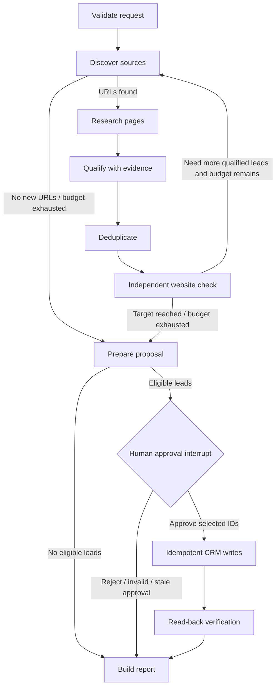

# Architecture and orchestration contract

## Goals

The workflow is designed for the Lead Research & CRM Loader brief: find companies for a sales request, retain checkable public evidence, avoid duplicates, ask for human approval, write approved records, and independently verify the result.

The design deliberately separates **judgment** from **invariants**:

- The LLM interprets ambiguous evidence and explains qualification decisions.
- Ordinary code validates the request, normalizes domains/names, applies employee-count limits, rejects invalid evidence citations, controls approvals, prevents common retry duplicates, and performs CRM read-back verification.
- An unavailable source is not automatically evidence that a company is inactive. Transient failures remain `unknown`.
- The agent never tries to bypass login, OTP, CAPTCHA, or other access controls.

## Graph nodes

| Node | Responsibility | Important output |
|---|---|---|
| `validate_input` | Validate request fields and ranges; establish a run ID | Normalized request and event |
| `discover_candidates` | Run several search queries in parallel, accumulate unique source URLs, and retry with different query angles up to the configured budget | Candidate URLs, search round and per-query failure events |
| `research_candidates` | Fetch public pages, extract text/links, preserve source evidence, and distinguish likely directory pages from an official company site | Candidate identity, website, evidence IDs/URLs/timestamps |
| `qualify_candidates` | Classify candidates as qualified/rejected/uncertain; check citation IDs and numeric company-size constraints | Decision, confidence, rationale, matched/missing criteria |
| `deduplicate` | Merge exact normalized-domain and exact normalized legal-name matches; keep uncertain/fuzzy matches visible rather than silently merging | One canonical identity plus explicit duplicate rows and alias domains |
| `verify_websites` | Re-check each established company site separately from discovery | Active/inactive/unknown status and check time |
| `prepare_proposal` | Select only qualified, active candidates and freeze exact proposed changes into a hash | Versioned import proposal |
| `approval_gate` | Pause the graph; validate reviewer decision, hash, and candidate IDs when resumed | Explicit approve/reject decision |
| `execute_import` | Write only selected candidate IDs from the exact approved proposal | Per-record CRM results and import statuses |
| `verify_import` | Read each created/existing CRM record back and compare intended name/domain | Verified or failed outcome |
| `build_report` | Summarize candidate, evidence, decision, approval and import states | Final auditable report |

## Workflow control

The target is a **goal, not permission to invent leads**. Search stops when enough active qualified leads are available or the configured research budget is exhausted. The report should make a shortfall visible rather than filling the target with weak or unsupported candidates.

## Core data contracts

- `LeadRequest`: stable request ID, industry, region, optional employee range, explicit qualification criteria and requested target.
- `Candidate`: stable candidate ID, candidate/company identity, normalized domain, website status, source evidence, decision, confidence, rationale, duplicate relationship and import state.
- `Evidence`: stable evidence ID, source URL/type, retrieval timestamp, excerpt and content hash.
- `ApprovalDecision`: reviewer ID, approve/reject decision, proposal hash and selected candidate IDs.
- `AgentReport`: final candidate rows, events, counts, failures and notes.

All web evidence is untrusted input. A page may contain promotional claims or adversarial instructions; those are data, never instructions to the agent. LLM prompts tell the model to use only provided evidence and return exact evidence IDs. Invalid citations or missing evidence cannot support an automatic qualification.

## Safety and reliability invariants

1. No CRM write occurs before the approval interrupt resumes with a valid decision.
2. Approval must match the exact proposal hash and may reference only IDs included in that proposal.
3. Only qualified candidates with an independently reachable official company site are proposed for import.
4. Directory URLs are kept as evidence; a directory's domain is not treated as the company's domain when an official URL cannot be established.
5. Uncertain candidates stay visible but are not automatically imported.
6. Exact domain/name duplicates are merged; fuzzy matches should become review suggestions, not automatic merges.
7. CRM writes use PostgreSQL idempotency keys and check for existing domain/name records before creating.
8. Every imported/existing record is read back and compared with the intended name/domain.
9. 404/410 mark a site inactive for this scenario; timeout, 429, 5xx and ambiguous outcomes remain inconclusive unless independent evidence confirms inactivity.
10. Restricted contact pages are skipped without authentication attempts or bypasses.

## State persistence and human approval

The API assigns the run ID as LangGraph's `thread_id`. The PostgreSQL checkpointer saves graph state when the `approval_gate` calls `interrupt(...)`; the approval endpoint resumes that same thread with `Command(resume=...)`. Keep the proposal preparation outside the interrupt node because LangGraph may re-run that node when a paused graph resumes.

The current API has no reviewer authentication. It binds approval to a proposal and reviewer ID, but production deployment must additionally authenticate the reviewer and verify authorization to approve that run.

## Adapters

- `SearchProvider`: Tavily in live mode; deterministic fake search results in mock mode.
- `WebsiteReader`: bounded `httpx` + BeautifulSoup reader in live mode; canned pages in mock mode.
- `QualificationService`: optional structured-output LLM with conservative rule-based fallback for offline demos.
- `CRMAdapter`: PostgreSQL CRM in application runs; in-memory adapter in offline tests and when `DATABASE_URL=memory://`.

The adapters can be replaced without changing graph control flow. This is useful for a deterministic test suite, switching search providers, or using Browserbase/Playwright behind a carefully tested public-page reader later.

## Known production gaps

Before exposing this to real users, add reviewer authentication/authorization, shared import locks for multi-worker deployments, provider-level rate budgets/domain delays, observability with sensitive values redacted, and tests for rate limits, redirect chains, network failures, and ambiguous entity matches. The public-page reader's SSRF checks reduce risk but are not a substitute for an isolated network sandbox in a high-risk production service.
